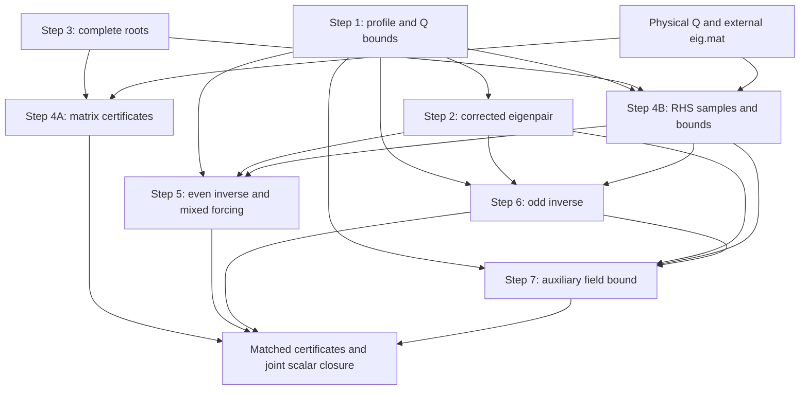

# Notebook Verification Pipeline

The **seven notebooks, Steps 1–7**, compute the residual, spectral, operator and
functional bounds used by the paper. Step 4 contains two parts in
`finite_rank_construction.ipynb`: Part 4A verifies the finite spectral system and
Part 4B constructs its forcing samples and derivative bounds.

Use a Julia kernel with `notebooks/` as its working directory. Select
`dtype = Interval{Float64}` in `src/NS_Numerics.jl` before loading the module;
`Float64` mode is for exploratory calculations. The [data reference](data.md)
describes file layouts, and the [paper–code map](paper_code_map.md) explains
notation, signs and the connection to the analytic estimates.

## Quick pipeline table

`external/` and `generated/` below are under `data/`. Every `eig.mat` input means
`data/external/eig.mat`; `data/eig.mat` is not an active loading path.

| Stage | Notebook | Direct external inputs | Direct generated inputs | Writes / reports |
|---|---|---|---|---|
| 1 | [selfsimilar_profile_verification.ipynb](../notebooks/selfsimilar_profile_verification.ipynb) | `UP.mat`, `approx_Q.mat` | Reuses the generated Q sample cache if present | `UP_divfree.mat` unconditionally, **before assertions**; `Q_bound_radial.mat`; generated `approx_Q.mat` if absent; profile/Q/compensation checks |
| 2 | [eigenpair_error_analysis.ipynb](../notebooks/eigenpair_error_analysis.ipynb) | `up_eig.mat` | `UP_divfree.mat` | `up_eig_corrected.mat` only if absent; normalized eigenpair checks |
| 3 | [get_bessel_zeros.ipynb](../notebooks/get_bessel_zeros.ipynb) | None | None required by the enumerator | `bessel_zeros.mat` after a successful complete root search |
| 4A | [finite_rank_construction.ipynb](../notebooks/finite_rank_construction.ipynb), Part 4A | `approx_Q.mat`, `eig.mat` | `bessel_zeros.mat`; existing angular/A–B caches may bypass assembly | `integrate_θ_result.mat`, `psi_eig_mat_AB.mat`; spectral and projection-error assertions |
| 4B | Same notebook, Part 4B | `UP.mat` for its scale, `approx_Q.mat`, `eig.mat` | `bessel_zeros.mat`, `Q_bound_radial.mat` | Matched `rhs.mat` and `rhs_bound.mat`; both present bypasses generation |
| 5 | [selfsimilar_linear_operator_finite_rank.ipynb](../notebooks/selfsimilar_linear_operator_finite_rank.ipynb) | `eig.mat`, `phi_even/UP_phi_*.mat` | `UP_divfree.mat`, `up_eig_corrected.mat`, `rhs.mat`, `rhs_bound.mat` | `step5_even_matrices.mat`; even inverse checks and mixed-forcing trace assertion; `B0_U=1+A0_U` is derivable but not printed |
| 6 | [eigen_linear_operator_finite_rank.ipynb](../notebooks/eigen_linear_operator_finite_rank.ipynb) | `eig.mat`, `phi_odd/up_phi_*.mat` | `UP_divfree.mat`, `up_eig_corrected.mat`, `rhs.mat`, `rhs_bound.mat` | `step6_odd_matrices_clean.mat`; odd residual/operator/quadratic checks |
| 7 | [verify_auxiliary_field_bound.ipynb](../notebooks/verify_auxiliary_field_bound.ipynb) | `eig.mat`, `phi_odd/up_phi_*.mat` (lambda only), `up_w.mat` | `UP_divfree.mat`, `up_eig_corrected.mat`, `rhs.mat`, `rhs_bound.mat`, `step6_odd_matrices_clean.mat` | Prints `M5_v_upper`, asserts ≤ `inf(dt("14.9512"))`; no output file |

The installed inputs contain 18 even and 25 odd trial inverse fields; the
[input table](data.md#input-coefficient-files) records their dimensions. Consumers derive their rank
from the matching RHS/eigenbasis arrays. Ordering must agree across those arrays
and the indexed inverse files. Steps 5, 6 and 7 consume
Step 4B's forcing; they do not directly load Q coefficients or Bessel roots.

Step 3 can be prepared independently. Step 2 needs Step 1's projected profile.
Part 4B needs Step 1's Q derivative export and Step 3's roots, but does not read
Part 4A's matrix caches. Its supplied eigenvectors nevertheless need Part 4A's
certificates for the proof. Steps 5 and 6 remain independent of one another's
result files. Step 7 additionally requires the complete
Step 6 output: its `GQ,GR,t,b` determine the source centers and their allowance.
The inner-only checkpoint is insufficient.



## Notebook-by-notebook execution map

### Step 1 — `selfsimilar_profile_verification.ipynb`

The loader reconstructs the divergence-free approximate profile `UP`. The
weighted residual is the difference between convection and the base linear
operator, including its pressure term:

```julia
err = mul_A_gradB(UP, UP, β_pt, θ_pt) - apply(lin_mat, UP)
```

Frequency bounds and Newton–Cotes remainders enclose its physical L² norm. The
radial coordinate is $r_{\rm phys}=\kappa\tan\beta$; the compactified endpoint
$\beta=\pi/2$ represents infinity. The [operator conventions](technical_notes/ns_terms.md)
explain the weight and physical measure.

Q is the same physical symmetric tensor used downstream. Its argument is
$x_Q=(\pi/2)r_{\rm phys}/R$, with $R=32$. Native derivative bounds are reported
in normalized radius $s=r_{\rm phys}/R$ and exported in `Q_bound_radial.mat`.
The order-ten refinement of Q composed with beta uses 15 ghost layers and a
`24031 × 6031` sample grid. Its cache is **generated `approx_Q.mat`**, distinct
from the external coefficient file of the same name. The separate order-two
matrix refinements use `derivative_padding(2)=1`.

Spectral estimates sample the smooth quotient $H=Q/\cos(x_Q)$, evaluated by
direct division at ordinary nodes and the exact mode limits at the support endpoint.
Matrix-entry interpolation/Weyl
allowances bound the minimum eigenvalue of H and maximum eigenvalue of Q; this
is not a frequency correction applied to eigenvalue samples. The compensation
check splits beta at `Beta=atan(R/κ)`. Its inner allowance combines beta/theta
second-derivative bounds for Q and the symmetric gradient; its exterior
allowance uses only the gradient. Mesh spacings and derivatives use the same
coordinates. The smaller regional lower bound is checked after adding `eta1`.

The target values are in the [check table](#current-acceptance-and-reporting).
The profile export is written before the assertions; run the complete notebook
to evaluate the residual, positivity and compensation checks.

### Step 2 — `eigenpair_error_analysis.ipynb`

With the fixed background `UP`, the weighted residual is

```julia
err = U_grad_u + u_grad_U - apply(lin_mat, up) - I_up * lbd
```

Global derivative priors use a full beta period. The physical residual refinement
uses `36000 × 18000` intervals with ten ghost layers (`36021 × 18021` samples),
then trims before integration. It uses `Linf_to_paras(...; ind=1)` so its angular
pass does not assume radial Bernstein on the physical quarter interval.

Writing `err_v=⟨err,I_up⟩` and `v_v=⟨I_up,I_up⟩`, the correction is
`λ_new=lbd+err_v/v_v`; the plus sign follows from `-I_up*lbd`. Dividing the common
velocity/pressure coefficients by `u_L2=sqrt(v_v)` encloses one distinguished
exactly unit candidate used by the projection formulas in Steps 6 and 7.

`up_eig_corrected.mat` supplies this candidate and corrected eigenvalue to
Steps 5, 6 and 7. It is written only when absent: new calculations do
not refresh an existing corrected export. Recreate that export when changing
the candidate or its normalization. Step 7 bounds the composed eigenvalue functional.

### Step 3 — `get_bessel_zeros.ipynb`

The roots of `func_Y` and `func_Z` define the poloidal and toroidal natural-Stokes
basis. The current enumerator searches through the first family pole strictly
above `R_CUT=100`, requires a certified root on every necessary complete
pole-free interval, and retains only enclosures strictly below the cutoff.
Missing required brackets abort. A cutoff-straddling enclosure is refined or
rejected; it is not silently omitted.

Completeness also uses the family uniqueness, pole-spacing and degree-cutoff
arguments in the [root certificate](technical_notes/bessel_zeros_certificate.md).
The special degree-one zero mode is included. Counts follow the generated lists and
determine the basis sizes used downstream.

### Step 4A — `finite_rank_construction.ipynb`, Part 4A

On raw physical Bessel modes $b_p$, Part 4A assembles
$A_{pq}=\langle b_p,Qb_q\rangle$ and
$B_{pq}=\eta_2\langle b_p,b_q\rangle+\langle\nabla b_p,\nabla b_q\rangle$,
with `eta=0.005`. Natural-Stokes orthogonality makes B diagonal, but the raw
modes are not assumed unit-normalized. Interval errors and the physical factor
$4\pi R^3$ are applied once. See [finite-rank assembly](technical_notes/finite_rank_assembly.md).

For supplied eigenvectors V and eigenvalues $\Lambda$, `verify_general_eig`
checks positivity of
$\tau B-A+(AV)\Lambda^{-1}(AV)^*$. On the Q-orthogonal complement the deflation
term vanishes, so this is a sufficient certificate for the required constrained
K6 bound. It is not an identity between constrained and deflated suprema.
Separate current K6 candidates and the epsilon3/epsilon4 assertions appear below.
The computed epsilon3 is a Frobenius upper bound for the manuscript spectral
error. Epsilon4 uses the B-weighted weak residual divided by the energy-Gram
conditioning factor; the [map](paper_code_map.md#finite-rank-matrices-and-certificates)
gives the exact formulas.

The final A/B cache is checked before assembly inputs. A hit skips assembly;
on a miss, the angular cache is reused or built before radial integration.
Part 4A prints its checks and returns the projection errors but writes no scalar
certificate file. Part 4B reads its external eigenvectors independently.

### Step 4B — `finite_rank_construction.ipynb`, Part 4B

Each retained $\psi_j=\sum_pV_{pj}b_p$ uses the same physical basis and ordering
as Part 4A. Reconstruct $Q\psi_j$ at normalized radius
$r=(\kappa/R)\tan\beta$ and Q argument $(\pi/2)r$, then multiply by
$w=\tan\beta/\cos\beta$. The saved `rhs_even` and `rhs_odd` already contain w
but **no eigenvalue division**. Their support is the ball $B_{32}$.

Bessel/chain-rule bounds provide radial priors; angular symmetry supplies angular
frequency bounds. Product bounds combine Q, the basis and w. The physical grid
has `12000 × 6000` intervals. Basis sampling uses 25 layers; refinement leaves a
ten-layer enlargement, on which Q and the RHS are formed. The saved RHS retains
ten layers and the derivative table bounds orders zero through eight. See the
[RHS note](technical_notes/finite_rank_rhs.md) for layouts and the exact padding
handoff.

Part 4B skips generation when both `rhs.mat` and `rhs_bound.mat` exist; if either
is missing, it rebuilds both. They must remain a matched pair with the same Q, roots, scale,
eigenbasis and discretization. File existence does not check those identities.

### Step 5 — `selfsimilar_linear_operator_finite_rank.ipynb`

Step 5 loads raw even trial inverse columns $\Phi_i$, the projected profile,
corrected unit v, and the matched RHS. Its explicit weighted residual is
$w[Q\psi_i+C_U(\Phi_i)-D\Phi_i-\Delta\Phi_i-\nabla p_i]$.
The [sign reference](paper_code_map.md#raw-inverse-fields-and-residuals) distinguishes
these loaded fields from the manuscript inverse fields.

The operator-side prior uses beta in $[0,\pi]$: the pressure and velocity terms
have mixed parity at $\pi/2$. Its frequency ceiling `freq_mixed` uses the sum of
background and inverse dimensions. Inner and outer residuals use explicit radial
priors, ten layers and the special refinement path before integration. Their
contributions form the complete raw `GR`; forcing `GQ` needs only the inner
region and includes both eigenvalue denominators.

The checks use a spectral bound for `C_U`, Gram operator bounds for `A0_U`
and `A1_U`, the trace/HS residual bound `K7_U`, and physical gradient/convection
aggregates. The triangle inequality also gives `B0_U=1+A0_U`. For the mixed forcing
$F_j=(\Phi_j\cdot\nabla)v+(v\cdot\nabla)\Phi_j$, the code computes
`Theta_F_U=sqrt(sum(GQ .* GF))`. This Hilbert–Schmidt bound controls the operator
required in the eigenpair forcing estimate. Full-period derivative priors and
`ind=1` supply its radial and angular refinement bounds.

The final save contains `GQ`, `GR`, `G_phi`, `G_Dphi`, `GF`, `inpd_tensor`, `N`,
`phi_grad`, `phi_product` and `K7_U`. Inline C/A/B candidates and the Theta scalar
are not saved. The field layouts are listed in [data.md](data.md).

### Step 6 — `eigen_linear_operator_finite_rank.ipynb`

Step 6 keeps raw odd inverse columns during prior and residual construction.
`lbd` is the corrected eigenvalue, each supplied `lbd_lst[i]` is a trial
constraint multiplier, and `eig_val[i]` is the retained spectral eigenvalue.
The complete raw residual Gram includes the exterior region. The nonsymmetric
crosses `G_BR` and `G_Bphi` divide each row by its eigenvalue once; forcing
support means these crosses need no exterior contribution.

After computing $b_i=\langle v,\Phi_i\rangle$, the code certifies both signs of
the raw residual quadratic form with one remaining budget
$\rho_v-\epsilon_v\sqrt{b^*GQb}$. The literal `epsilon_v=4.808e-6` must be backed
by Step 2's bound for the same normalized v, pressure, background and eigenvalue.
Interval code uses `sqrt(abs(b' * GQ * b))` to enclose this nonnegative square root.
This correction is included once in the final residual bound.

Late mass, gradient and cross projections use
$H-bb^*$, $D_\phi-bd^*-db^*+d_0bb^*$ and $X-tb^*$, respectively. The
[exact formulas](paper_code_map.md#late-odd-projection) explain the operator and
symmetric-part certificates. Both signs of the symmetric part of G are tested
at `32.52`, giving the paper constant $\Theta_{\mathrm s}^v\le1+32.52=33.52$.
The variable holding this bound is `Bquad_v`.

The final output stores raw/projected Grams, `b,d,d0,t`, `K7_v_correction`,
`K7_v` and `Bquad_v`; inline `A0_v`, `A1_v`, `B0_v` candidates are not fields in
the file. There is no odd trace calculation in Step 6. Step 7 reads this complete
file. The Gram spectral assertions use the
[upper-matrix certificate](technical_notes/matrix_func.md#symmetric-and-gram-spectral-certificates).

<a id="step-7"></a>
### Step 7 — `verify_auxiliary_field_bound.ipynb`

Use the trial auxiliary field w and matched Step 4/6 data to bound the composed
weighted functional, denoted M5 in the paper, in the dual of
$\|u\|_{H^1_{\eta_v}}=\sqrt{\eta_v\|u\|_2^2+\|\nabla u\|_2^2}$,
with `eta_v=0.23187`. It reads inverse multipliers `lambda`, not inverse-field
samples or fresh source-pairing integrals. Matched Step 6 `GQ,GR,t,b` provide
fixed binary centers of `lambda_phi - nu .* t` and a separate interval allowance
`delta_M5` for the exact source. See the
[coefficient identity and energy derivation](paper_code_map.md#direct-mass-weighted-m5).

The five source-free fields are w, v, their Laplacians and the initial Z. Global
priors use `12000 × 3000` intervals on the full beta period; each physical
refinement uses explicit beta priors with `ind=1` and ten padding layers. The
inner physical grid is `12000 × 6000`, with Step 4B slices `11:12011,11:6011`;
the exterior grid is `9000 × 6000` and extends through compactified infinity.
The stored RHS already contains the radial weight.

The full interval projection coefficient `gamma=<w,v>` enters the projected
trial and derivative tables. Source centers are divided by nu once. The final
cell updates Z in place, so regenerate its samples and bounds before repeating
that cell. Native NC8 inner products, including both directional remainders,
give `w1` and `z2`. The code evaluates
`M5_center=sqrt(w1+z2/eta_v)` and
`M5_v_upper=sup(M5_center+delta_M5)`, prints the latter, and asserts
`M5_v_upper <= inf(dt("14.9512"))`. It writes no result file and does not print cs.

The paper rounds this bound to $M_5^v\le15$. It uses the larger mass weight
$\eta_v=0.232$ in its eigenpair ball: a dual energy norm decreases when the
mass weight increases, so the Step 7 estimate remains valid there.

<a id="current-acceptance-and-reporting"></a>
## Notebook checks and paper bounds

The table compares executable checks with the inputs in the paper's Numerical
results section. The labels in the last column identify the corresponding equations
in the paper.

| Stage | Quantity | Executable check | Bound used in the paper / label |
|---|---|---|---|
| 1 | Profile residual | ≤ `4.969e-6` | $\varepsilon^U=4.97\times10^{-6}$; `eq:45-input-EU` |
| 1 | Q positivity | Minimum eigenvalue of $H=Q/\cos(x_Q)$ ≥ 0 | $Q\succeq0$; `eq:45-input-Q-positive` |
| 1 | Q spectral bound | ≤ `4.46964` | ≤ 4.47; `eq:45-input-Q-max` |
| 1 | Compensation | $Q_s+Q+0.19084I\succeq0$ | $\eta_1=0.1909$; `eq:45-input-Q-condition` |
| 2 | Normalization | Lower endpoint of `v_v` > 0 | $\lVert \overline v\rVert_2=1$; `asm:num` |
| 2 | Corrected eigenvalue | ≤ `-0.1131623` | ≤ −0.1131; `eq:45-input-lambda` |
| 2 | Normalized residual | ≤ `4.808e-6` | $\varepsilon^v=4.81\times10^{-6}$; `eq:45-input-Ev` |
| 2 | Velocity / gradient L∞ | ≤ `0.0318488` / `0.0431148` | ≤ 0.0319 / 0.0432; `eq:45-input-v`, `eq:45-input-grad-v` |
| 4A | K6, even / odd | `0.449` / `0.445` matrix tests | Same bounds; `eq:45-input-K6`, `eq:45-input-K6v` |
| 4A | Epsilon3 / epsilon4 | ≤ `2.8e-7`, both sectors | Same bounds; `eq:45-input-errors` |
| 5 | C_U | `5.24693` spectral test | $\Theta_Q^U\le5.25$; `eq:45-input-GU` |
| 5 | A0_U / A1_U | `4.28080` / `4.79779` Gram tests | $\Theta_\phi^U\le4.29$, $\Theta_{\nabla\phi}^U\le4.8$; `eq:45-input-phi-U`, `eq:45-input-gradphi-U` |
| 5 | K7_U | ≤ `0.000453683` | $\Theta_r^U\le0.000454$; `eq:45-input-rU` |
| 5 | Gradient / convection aggregates | ≤ `0.369356` / `0.679897` | ≤ 0.37 / 0.68; `eq:45-input-grad-phi-U`, `eq:45-input-product-U` |
| 5 | Theta_F_U | Printed interval; assertion ≤ `0.0638` | Same bound; `eq:45-input-FU` |
| 6 | K7_v | Two signed tests with the projection allowance included; target `0.02690` | $\Theta_r^v\le0.027$; `eq:45-input-rv` |
| 6 | A0_v / A1_v | `52.01` / `45.51` Gram tests | $\Theta_\phi^v\le52.1$, $\Theta_{\nabla\phi}^v\le45.6$; `eq:45-input-Gv`, `eq:45-input-grad-Gv` |
| 6 | B0_v | `52.20` cross-Gram test | Additional operator bound for $I+G^v$ |
| 6 | Bquad_v | Both signs of $\operatorname{sym}G^v$ tested at `32.52`; add 1 | $\Theta_{\mathrm s}^v\le33.52\le33.6$; definition following `eq:new coercivity v` |
| 7 | M5_v at mass weight `0.23187` | Printed upper endpoint ≤ `14.9512` | $M_5^v\le15$; `eq:45-input-M5v` |

For the mixed forcing, the saved interval `[0.0637154, 0.0637174]` satisfies
the asserted upper bound of 0.0638 used in the paper.

<a id="cache-dependencies"></a>
## Cache dependencies

Some cells load a generated file whenever it exists. These guards do not compare inputs
or numerical settings. Rebuild affected files when changing their inputs, and keep the
RHS samples and derivative bounds together.

| Changed object | Affected descendants |
|---|---|
| Profile coefficients or divergence reconstruction | Projected profile, corrected eigenpair, inverse residuals, mixed forcing and auxiliary functional |
| Scale or support radius | Coordinate-dependent Q samples/bounds, finite-rank matrices, RHS and downstream integrals |
| Q, Bessel roots or basis ordering | Q/angular/A–B caches, RHS samples/bounds and dependent Grams |
| Retained eigenvectors/eigenvalues | Part 4A tests, Part 4B fields/bounds and all finite-rank quantities |
| Corrected eigenfunction or eigenvalue | Step 5 mixed forcing, Step 6 residuals/projections and Step 7 source/projection |
| Inverse trial field | Its residual, mass/gradient/cross/forcing Grams and derived bounds; Step 6 Grams and multipliers also feed Step 7 |
| Auxiliary source, mass weight or trial | Step 7 residual and functional estimate |

The corrected eigenpair export and Q sample cache are written only when absent.
The Bessel table and final Step 5/6 matrix saves write their destinations when their
cells execute. Step 4A reuses A/B matrices before considering the angular cache;
Step 4B skips generation when both RHS files exist.

## How the numerical bounds enter the proof

Section `Sec:num prev` of the paper first combines the spectral tail, K6, Gram errors
and residual bounds through `eq:finite-rank-constants`. For the profile it obtains
$M_1^U<0.9068$, $M_2^U<0.005$, and chooses $a^U=0.0541$, $b^U=0.0932$.
The convection and gradient aggregates yield $M_3^U<4.42$ and a positive discriminant,
so the profile energy ball has radius $R_U<7.06\times10^{-5}$.

The refined joint profile estimate `eq:U-joint-bound` controls the forcing and
profile-dependent eigenvalue functional. The eigenpair argument uses
$\eta_v=0.232$, $R_v=0.00016$, $M_5^v\le15$ and
$\Theta_{\mathrm s}^v\le33.6$. Its scalar margins verify the invariant ball in
`eq:45-v-radius-budget`. Finally `eq:45-v-lambda` bounds the eigenvalue correction
by 0.00243, and the corrected approximate eigenvalue gives
$\widetilde\lambda<-0.1106<0$.

These scalar combinations and the analytic existence argument are written out in
the paper. The [paper–code map](paper_code_map.md) identifies each numerical ingredient.
